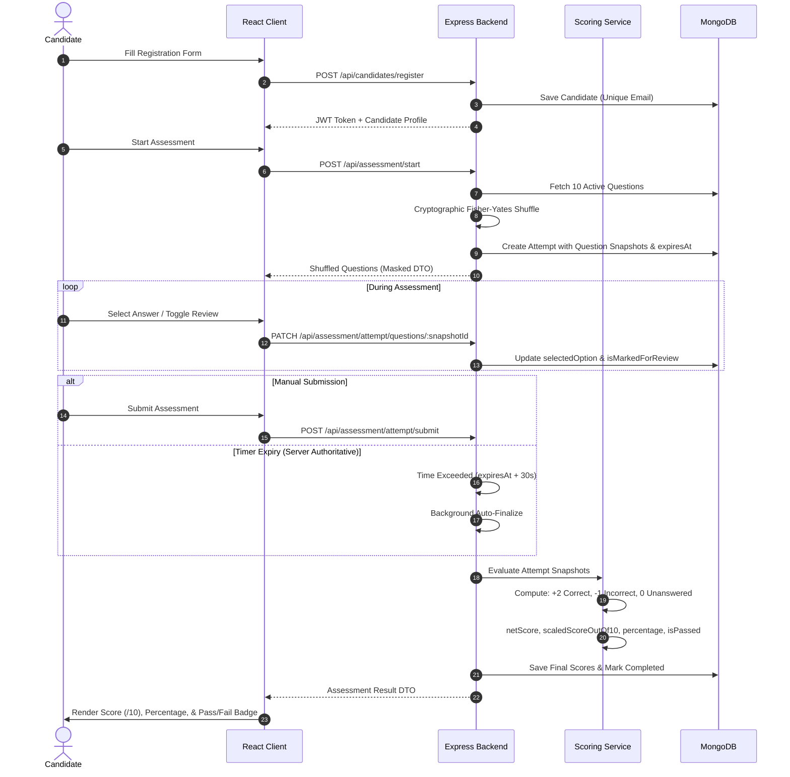

# Aptitude Assessment Dashboard

[]()
[]()
[]()
[]()
[]()

A full-stack, enterprise-grade Aptitude Assessment Dashboard built with the MERN stack (MongoDB, Express, React, Node.js). Engineered to fulfill the requirements of the **Full Stack Developer and AI Specialist** coding assignment, this system features a timed candidate assessment environment with negative marking, server-authoritative timer enforcement, automatic timeout finalization, state recovery across browser restarts, and an administrative suite with real-time analytics, question bank management with an atomic 10-active-question invariant, candidate transcripts, and CSV/Excel exports with CWE-1236 spreadsheet injection protection.

---

## Table of Contents
1. [Project Overview](#1-project-overview)
2. [Key Candidate Features](#2-key-candidate-features)
3. [Key Administrator Features](#3-key-administrator-features)
4. [Technology Stack](#4-technology-stack)
5. [System Architecture Overview](#5-system-architecture-overview)
6. [System Requirements](#6-system-requirements)
7. [Installation & Quick Start Guide](#7-installation--quick-start-guide)
8. [Frontend Environment Configuration](#8-frontend-environment-configuration)
9. [Backend Environment Configuration](#9-backend-environment-configuration)
10. [Database Configuration & Production Indexing](#10-database-configuration--production-indexing)
11. [Database Models & Schema Design](#11-database-models--schema-design)
12. [Database Seeding & Data Integrity](#12-database-seeding--data-integrity)
13. [Default Seeded Credentials](#13-default-seeded-credentials)
14. [Automated Testing Guide](#14-automated-testing-guide)
15. [Production Build Verification](#15-production-build-verification)
16. [Comprehensive API Reference](#16-comprehensive-api-reference)
17. [Assessment Evaluation & Scoring Logic](#17-assessment-evaluation--scoring-logic)
18. [Key Assumptions & Assignment Alignment](#18-key-assumptions--assignment-alignment)
19. [AI Tools Disclosure & Methodology](#19-ai-tools-disclosure--methodology)
20. [Prompt Evolution History (Phases 1–6)](#20-prompt-evolution-history-phases-16)
21. [Walkthrough Demonstration & Video Recording Script](#21-walkthrough-demonstration--video-recording-script)
22. [Production Deployment Guide](#22-production-deployment-guide)
23. [Known Limitations & Production Roadmap](#23-known-limitations--production-roadmap)

---

## 1. Project Overview

The Aptitude Assessment Dashboard provides an end-to-end evaluation environment for corporate hiring and skill assessments.

The application addresses critical challenges in online assessments:
- **Integrity & Security:** Questions are shuffled cryptographically per candidate, and answer keys are never transmitted to the client browser until final evaluation.
- **Server-Authoritative Timing:** Browser timers act purely as visual displays. The backend strictly enforces question cutoff at expiration and provides a 30-second submission grace period for high-latency network conditions.
- **Atomic Concurrency & Invariants:** The question bank enforces an invariant of exactly 10 active questions via MongoDB collection validators, compound partial unique indexes, and a crash-safe replacement journal.
- **Auditability:** Question snapshots inside candidate attempts ensure historical scoring remains completely immutable even if questions are subsequently updated or deactivated by administrators.

---

## 2. Key Candidate Features

- **Candidate Registration:** Capture applicant details (`fullName`, `email`, `phone`, `age`, `gender`, `qualification`, `city`) with client and server Zod validation. Duplicate registration handling prevents retakes after completion while allowing session resumption if incomplete.
- **Assessment Instructions:** Clear pre-test briefing disclosing duration (15 mins), question count (10), marking scheme (+2 / -1 / 0), and 60% passing threshold.
- **Interactive Question Palette:** 1-to-10 navigation grid displaying real-time visual states:
  - *Answered* (Solid Indigo)
  - *Unanswered* (Neutral Gray)
  - *Marked for Review* (Purple with bookmark badge)
  - *Active Question* (Highlighted ring)
- **Real-Time Autosave:** Debounced background answer synchronization and review status toggling with monotonic sequence tracking.
- **Seamless State Recovery:** Candidate answers, review flags, and elapsed time survive accidental tab closures, browser crashes, and page refreshes.
- **Pre-Submission Summary Modal:** Displays counts of answered, unanswered, and flagged questions before final confirmation.
- **Automatic Timeout Finalization:** Server and client countdown timers trigger automatic submission upon expiry. Answers cannot be submitted after the cutoff.
- **Detailed Result Breakdown:** Instant score computation displaying:
  - **Scaled Score (out of 10)** as the primary prominent metric
  - **Percentage (%)**
  - **Net Raw Marks (out of 20)**
  - Correct, Incorrect, and Unattempted question counts
  - Time taken
  - Clear **PASSED** / **FAILED** status badge against the 60% cutoff

---

## 3. Key Administrator Features

- **Secure Administrator Authentication:** Email and password authentication with bcrypt (12 salt rounds), JSON Web Tokens (JWT), rate limiting, and database-level active-account verification.
- **Executive Analytics Dashboard:**
  - Key Performance Indicators (KPIs): Total Candidates, Completed Assessments, In-Progress Attempts, Pass Rate, Average Score, Highest & Lowest Scores.
  - Interactive Visualizations: Pass/Fail Donut Chart, Score Distribution Bar Chart, Category-wise Performance Radar Chart, and 7-day Registration/Completion Velocity.
- **Question Bank Management:**
  - Comprehensive question browser with pagination, text search, category filters (Quantitative, Logical Reasoning, Verbal), and difficulty filters.
  - CRUD operations with strict enforcement of the **strictly 10 active questions** invariant.
  - **Atomic Replacement Modal:** Seamlessly swap an active question with a reserve question with zero downtime or invariant violation.
  - **Referential Integrity Guard:** Prevents deletion of questions referenced in historical candidate attempts.
- **Candidate Assessment Directory:**
  - Zero-N+1 paginated table showing Name, Email, Phone, Age, Scaled Score (/10), Percentage, Status (Passed/Failed/In Progress), and Date of Attempt.
  - Full-text search by name or email, pass/fail status filtering, and sorting by registration date, submission date, or score.
- **Candidate Assessment Transcript:** Detailed modal inspection of an applicant's attempt, showing assigned question order, selected options, correct answers, and comprehensive answer explanations.
- **Secure Data Exports:**
  - RFC 4180 compliant CSV export.
  - Microsoft Excel SpreadsheetML (.xls) export with true numeric formatting.
  - **CWE-1236 Formula Injection Sanitization:** Automatic single-quote escaping on untrusted strings beginning with `=`, `+`, `-`, or `@`.
- **System Settings Configuration:** Global configuration for test duration (5–180 minutes), passing percentage (0–100%), and marking weights with historical snapshot preservation.

---

## 4. Technology Stack

### Backend
- **Runtime:** Node.js (v20+ LTS / v22+)
- **Framework:** Express.js (v4.21+) using native ES Modules (`"type": "module"`)
- **Database:** MongoDB (v6.0+ / v7.0+) with Mongoose ODM (v8.10+)
- **Security & Middleware:** Helmet, CORS, Express Rate Limit, Morgan, `bcryptjs`
- **Authentication:** JSON Web Tokens (`jsonwebtoken`)
- **Validation:** Zod (v3.24+) and Mongoose Schema Validators
- **Testing:** Vitest (v3.0+), Supertest, `mongodb-memory-server` (v10.1+)

### Frontend
- **Framework:** React (v18.3+) with Vite (v6.2+)
- **Language:** Modern JavaScript / JSX
- **Styling:** Tailwind CSS (v3.4+), PostCSS, Autoprefixer
- **Routing:** React Router DOM (v6.29+)
- **Form Management:** React Hook Form (v7.54+) with `@hookform/resolvers/zod`
- **Data Visualization:** Recharts (v2.15+)
- **Icons & UI:** Lucide React, Tailwind Merge, CLSX
- **Testing:** Vitest (v5.1+), `@testing-library/react`, `@testing-library/jest-dom`, JSDOM

---

## 5. System Architecture Overview

```mermaid
flowchart TD
    subgraph Client ["Frontend (React 18 + Vite)"]
        CR["Candidate Registration & Instructions"]
        CRoom["Assessment Room (Timer + 10Q Palette)"]
        CRes["Result Page (Score / 10 & Breakdown)"]
        ALogin["Admin Login"]
        ADash["Admin Dashboard (KPIs + Charts)"]
        AQBank["Question Bank (10Q Invariant + Swap)"]
        ACand["Candidate Management & Transcript"]
    end

    subgraph API ["Backend API (Express.js on Node.js)"]
        AuthM["Auth & RBAC Middleware"]
        ValM["Zod Validation Middleware"]
        CandCtrl["Candidate Controller"]
        AssessCtrl["Assessment Controller"]
        ScoreSvc["Server-Side Scoring Engine"]
        AdminCtrl["Admin Management Controllers"]
        ExpirySvc["Background Expiry Worker"]
        SanitizeSvc["CWE-1236 Export Sanitizer"]
    end

    subgraph DB ["Database (MongoDB)"]
        M_Admin[("Admin Collection")]
        M_Cand[("Candidate Collection")]
        M_Q[("Question Collection (Slot 1-10)")]
        M_Att[("Attempt Collection (Snapshots)")]
        M_Set[("Settings Collection (Singleton)")]
        M_Jour[("ReplacementJournal Collection")]
    end

    CR -->|POST /api/candidates/register| CandCtrl
    CRoom -->|PATCH answers & GET attempt| AssessCtrl
    CRoom -->|POST submit| AssessCtrl
    AssessCtrl --> ScoreSvc
    CRes -->|GET /api/assessment/result| AssessCtrl
    
    ALogin -->|POST /api/admin/auth/login| AdminCtrl
    ADash -->|GET summary & analytics| AdminCtrl
    AQBank -->|CRUD & Swap| AdminCtrl
    ACand -->|List, Review & Export| AdminCtrl
    ACand --> SanitizeSvc

    API --> DB
    ExpirySvc -.->|Sweep expired attempts| M_Att
```



### Candidate Assessment Lifecycle



---

## 6. System Requirements

- **Node.js:** v20.x or v22.x LTS (tested on Node v22.14.0)
- **NPM:** v10.x+
- **MongoDB:** v6.0+ or v7.0+ (Local MongoDB instance or MongoDB Atlas cluster)
- **Operating System:** Windows, macOS, or Linux

---

## 7. Installation & Quick Start Guide

### Step 1: Clone the Repository
```bash
git clone https://github.com/dineshkumar-mb/Full-Stack-Developer-Assignment.git
cd Full-Stack-Developer-Assignment
```

### Step 2: Install Dependencies
You can install dependencies for both frontend and backend using the root helper script:
```bash
npm run install:all
```
*Or install manually in each folder:*
```bash
cd server && npm install
cd ../client && npm install
cd ..
```

### Step 3: Configure Environment Variables
Create `.env` files in both `server/` and `client/` directories:

**Server (`server/.env`):**
```env
NODE_ENV=development
PORT=5000
MONGODB_URI=mongodb://localhost:27017/aptitude_assessment
JWT_SECRET=your_super_secret_jwt_key_at_least_32_characters_long
JWT_EXPIRES_IN=1d
CLIENT_URL=http://localhost:5173
ADMIN_NAME=Assessment Administrator
ADMIN_EMAIL=admin@assessment.com
ADMIN_PASSWORD=AdminPassword123!
BCRYPT_SALT_ROUNDS=12
```

**Client (`client/.env`):**
```env
VITE_API_BASE_URL=http://localhost:5000/api
```

### Step 4: Seed Database
Seed the database with the default administrator, assessment settings, and exactly 10 corporate aptitude questions (4 Quantitative, 3 Logical Reasoning, 3 Verbal):
```bash
npm run seed
```
*(Or inside `server/`: `npm run seed`)*

### Step 5: Run the Applications
Open two terminal windows:

**Terminal 1 (Backend API):**
```bash
npm run dev:server
# Server running on http://localhost:5000
```

**Terminal 2 (Frontend Client):**
```bash
npm run dev:client
# Client accessible at http://localhost:5173
```

---

## 8. Frontend Environment Configuration

The frontend uses Vite environment variables prefixed with `VITE_`.

| Variable | Description | Default Development Value |
|---|---|---|
| `VITE_API_BASE_URL` | Base URL pointing to the backend API | `http://localhost:5000/api` |

---

## 9. Backend Environment Configuration

| Variable | Description | Default / Example Value |
|---|---|---|
| `NODE_ENV` | Runtime environment (`development`, `test`, `production`) | `development` |
| `PORT` | Port for the Express server to listen on | `5000` |
| `MONGODB_URI` | MongoDB connection string (local or Atlas) | `mongodb://localhost:27017/aptitude_assessment` |
| `JWT_SECRET` | Secret key for signing authentication tokens | *32+ character random string* |
| `JWT_EXPIRES_IN` | Token expiration time | `1d` |
| `CLIENT_URL` | Allowed origin for CORS policy | `http://localhost:5173` |
| `ADMIN_NAME` | Default administrator name for seeder | `Assessment Administrator` |
| `ADMIN_EMAIL` | Default administrator email for seeder | `admin@assessment.com` |
| `ADMIN_PASSWORD` | Default administrator password for seeder | `AdminPassword123!` |
| `BCRYPT_SALT_ROUNDS` | Salt rounds for password hashing | `12` |

---

## 10. Database Configuration & Production Indexing

The application leverages compound and partial unique indexes to guarantee high performance and enforce critical business invariants at the database layer.

| Collection | Index Specification | Purpose & Guarantees |
|---|---|---|
| `admins` | `{ email: 1 }` (unique) | Fast lookup and duplicate prevention for admin accounts |
| `candidates` | `{ email: 1 }` (unique) | Enforces single candidate registration by email |
| `candidates` | `{ fullName: 1 }` | Supports fast candidate search in admin table |
| `candidates` | `{ createdAt: -1 }` | Optimizes sorting candidate lists by signup date |
| `attempts` | `{ candidateId: 1 }` (unique) | Enforces strictly one attempt per candidate |
| `attempts` | `{ candidateEmail: 1 }` (unique) | Secondary candidate attempt guard |
| `attempts` | `{ status: 1, submittedAt: -1 }` | Fast aggregation for dashboard KPIs and completion queries |
| `attempts` | `{ 'scoreSummary.netScore': -1 }` | Optimizes score sorting and leaderboard views |
| `attempts` | `{ 'scoreSummary.isPassed': 1 }` | High-speed filtering for pass/fail candidate queries |
| `questions` | `{ activeSlot: 1 }` (unique, partial: `isActive: true`) | Concurrency guard ensuring strictly $\le 10$ active questions (slots 1–10) |
| `questions` | `{ category: 1 }`, `{ difficulty: 1 }` | Question bank filtering |
| `settings` | `{ singletonKey: 1 }` (unique) | Restricts settings collection to a single configuration document |
| `replacementjournals` | `{ status: 1, createdAt: -1 }` | Fast journal reconciliation on server boot |

---

## 11. Database Models & Schema Design

- **`Admin` (`server/models/Admin.js`):**
  Stores administrator credentials with pre-save bcrypt hashing, status flags (`isActive`, `role`), and password comparison helper methods.
- **`Candidate` (`server/models/Candidate.js`):**
  Stores applicant demographic data (`fullName`, `email`, `phone`, `age`, `gender`, `qualification`, `city`, `hasAttempted`).
- **`Question` (`server/models/Question.js`):**
  Defines assessment items with 4 options (`A`, `B`, `C`, `D`), `correctOption`, category (`Quantitative`, `Logical Reasoning`, `Verbal`), `difficulty`, `explanation`, `isActive`, and `activeSlot` (integer 1–10 for active, `null` for inactive).
- **`Attempt` (`server/models/Attempt.js`):**
  Tracks candidate assessment instances. Contains an array of 10 immutable `questionSnapshots` (capturing question text, options, assigned order, candidate's `selectedOption`, `isMarkedForReview`, and answer key), timestamps (`startedAt`, `expiresAt`, `submittedAt`), `status` (`in_progress`, `completed`, `timed_out`), and complete `scoreSummary`.
- **`Settings` (`server/models/Settings.js`):**
  Singleton document defining test duration (`testDurationMinutes`: 15), passing threshold (`passPercentage`: 60), and marking rules (`correctMarkWeight`: 2, `negativeMarkWeight`: 1).
- **`ReplacementJournal` (`server/models/ReplacementJournal.js`):**
  Crash-safe write-ahead log for active question swap operations. Guarantees that any server interruption during a question swap is automatically reconciled upon server startup.

---

## 12. Database Seeding & Data Integrity

The seeder suite is idempotent and safe to execute repeatedly without duplicating data.
```bash
npm run seed
```

### Seeded Question Bank (Exactly 10 Active Questions)
The assessment seeder loads 10 balanced corporate aptitude questions satisfying the required **4/3/3** distribution:

| Slot | Category | Question Subject | Correct Option |
|:---:|:---:|:---|:---:|
| 1 | Quantitative | Profit & Loss: 20% markup with 10% discount | **B (8%)** |
| 2 | Quantitative | Work & Time: P (12 days) and Q (16 days) working together | **B (6.86 days)** |
| 3 | Quantitative | Speed & Distance: Train 180m at 72 km/h crossing 220m platform | **C (20 seconds)** |
| 4 | Quantitative | Simple & Compound Interest: 2-year difference at 10% on $5,000 | **B ($50)** |
| 5 | Logical Reasoning | Coding-Decoding: SYSTEM -> SYSMET pattern applied to FRACTION | **C (CARFTION)** |
| 6 | Logical Reasoning | Blood Relations: Pointing to a photograph | **B (Sister)** |
| 7 | Logical Reasoning | Syllogisms: All laptops are devices, some devices are phones | **C (Neither I nor II follows)** |
| 8 | Verbal | Reading Comprehension: Automated AI testing in corporate hiring | **B (AI assessments improve screening)** |
| 9 | Verbal | Vocabulary in Context: Meaning of "Pragmatic" | **B (Practical and sensible)** |
| 10 | Verbal | Sentence Correction: Subject-verb agreement with collective nouns | **B (The team of researchers has published)** |

*(Plus 3 reserve inactive questions for testing the atomic replacement feature).*

---

## 13. Default Seeded Credentials

### Administrator Login
- **URL:** `http://localhost:5173/admin/login`
- **Email:** `admin@assessment.com`
- **Password:** `AdminPassword123!`
- **Role:** Administrator (`admin`)

### Candidate Assessment Flow
- **URL:** `http://localhost:5173/`
- No pre-seeded credentials required. Applicants register directly on the landing page with any valid email and details to immediately initiate a test session.

---

## 14. Automated Testing Guide

The project includes an automated test suite with **143 total tests** (118 backend tests + 25 frontend tests). All tests pass with zero failures.

### Run All Tests
```bash
npm test
```

### Run Backend Test Suite (Vitest + Supertest + In-Memory MongoDB)
```bash
cd server
npm test
```
**Coverage (118/118 passing across 14 test files):**
- `models.test.js`: Schema validation, email normalization, activeSlot unique index constraints.
- `authAndMiddleware.test.js`: Bcrypt hashing, JWT tokens, RBAC permissions, error middleware.
- `healthAndSeed.test.js`: Healthcheck endpoint, seeder idempotency, 4/3/3 category split verification.
- `candidateRegistrationAndAuth.test.js`: Registration validation, duplicate rejection, session resumption.
- `assessmentEngine.test.js`: Shuffling, answer persistence, question masking, timer expiry, 30s grace period.
- `scoringEngine.test.js`: +2/-1/0 scoring rules, negative net scores, scaled scores, threshold evaluation.
- `timerBoundariesAndConcurrency.test.js`: Boundary tests (T-1ms, T, T+1ms, T+30s, T+30s+1ms), DB-level expiry guards.
- `adminAuth.test.js`: Admin login, invalid password, inactive admin check, profile, logout.
- `adminDashboard.test.js`: KPI calculations, pass rate, average scores, chart analytics datasets.
- `adminQuestions.test.js`: Question CRUD, 10-active invariant, deactivation block, atomic replacement.
- `questionInvariantAndCrashSafety.test.js`: Crash-safe journal rollback, concurrent race protection, invalid slot boundaries.
- `adminCandidatesAndExport.test.js`: Zero-N+1 candidate listing, search, status filtering, CSV/Excel export, CWE-1236 injection sanitization.
- `adminSettings.test.js`: Global duration and pass % updates, range validation, historical attempt snapshot immutability.
- `e2eJourneyAndSecurity.test.js`: Complete end-to-end candidate registration, assessment lifecycle, admin review, and security barriers.

### Run Frontend Test Suite (Vitest + React Testing Library)
```bash
cd client
npm test
```
**Coverage (25/25 passing across 2 test files):**
- `candidateFlow.test.jsx`: Registration validation, instructions view, question navigation, timer countdown, answer selection, preview modal, manual submission, and result display.
- `adminFlow.test.jsx`: Admin login, analytics dashboard KPIs, question bank listing, atomic question swap modal, candidate search/filter, assessment review modal, CSV export trigger, and settings modification.

---

## 15. Production Build Verification

The frontend production build generates optimized, minified bundles using Vite:
```bash
cd client
npm run build
```
**Build Output Verification:**
```text
✓ 183 modules transformed.
dist/index.html                   0.85 kB │ gzip:  0.43 kB
dist/assets/index-Dk...css       24.12 kB │ gzip:  5.21 kB
dist/assets/index-C8...js       354.28 kB │ gzip: 105.79 kB
✓ built in 7.38s
```

---

## 16. Comprehensive API Reference

### Candidate & Assessment Endpoints

| Method | Endpoint | Description | Authentication |
|---|---|---|---|
| `POST` | `/api/candidates/register` | Register applicant and issue session token | Public |
| `GET` | `/api/candidates/me` | Fetch applicant profile and active attempt state | Candidate Bearer Token |
| `GET` | `/api/assessment/instructions` | Fetch rules, duration, and marking scheme | Public / Candidate |
| `POST` | `/api/assessment/start` | Initialize 10-question shuffled assessment | Candidate Bearer Token |
| `GET` | `/api/assessment/attempt/current` | Retrieve current attempt with saved answers | Candidate Bearer Token |
| `PATCH` | `/api/assessment/attempt/questions/:id` | Save answer selection or review flag | Candidate Bearer Token |
| `GET` | `/api/assessment/attempt/submission-preview` | Get pre-submit counts (answered/unanswered/review) | Candidate Bearer Token |
| `POST` | `/api/assessment/attempt/submit` | Finalize and submit assessment | Candidate Bearer Token |
| `GET` | `/api/assessment/result` | Retrieve final evaluated score breakdown | Candidate Bearer Token |

### Administrator Endpoints

| Method | Endpoint | Description | Authentication |
|---|---|---|---|
| `POST` | `/api/admin/auth/login` | Authenticate admin and return JWT | Public (Rate-limited) |
| `GET` | `/api/admin/auth/me` | Retrieve authenticated admin profile | Admin Bearer Token |
| `POST` | `/api/admin/auth/logout` | Stateless logout acknowledgment | Admin Bearer Token |
| `GET` | `/api/admin/dashboard/summary` | Retrieve KPI metrics (pass rate, avg score, etc.) | Admin Bearer Token |
| `GET` | `/api/admin/dashboard/analytics` | Retrieve chart datasets (trends, distribution) | Admin Bearer Token |
| `GET` | `/api/admin/questions` | List questions with search and filters | Admin Bearer Token |
| `POST` | `/api/admin/questions` | Create question (enforces $\le 10$ active limit) | Admin Bearer Token |
| `GET` | `/api/admin/questions/:id` | Get question details | Admin Bearer Token |
| `PATCH` | `/api/admin/questions/:id` | Update question content | Admin Bearer Token |
| `PATCH` | `/api/admin/questions/:id/status` | Activate/deactivate question (atomic swap support) | Admin Bearer Token |
| `DELETE` | `/api/admin/questions/:id` | Delete question (protected against active/referenced) | Admin Bearer Token |
| `GET` | `/api/admin/candidates` | Paginated candidate list with search & score sorting | Admin Bearer Token |
| `GET` | `/api/admin/candidates/:id` | Get candidate profile | Admin Bearer Token |
| `GET` | `/api/admin/candidates/:id/assessment` | View full question-by-question attempt review | Admin Bearer Token |
| `GET` | `/api/admin/candidates/export/csv` | Download candidate report as CSV (CWE-1236 safe) | Admin Bearer Token |
| `GET` | `/api/admin/candidates/export/excel` | Download candidate report as Excel (.xls) | Admin Bearer Token |
| `GET` | `/api/admin/settings` | Retrieve global duration and passing cutoff | Admin Bearer Token |
| `PATCH` | `/api/admin/settings` | Update global duration and passing cutoff | Admin Bearer Token |

---

## 17. Assessment Evaluation & Scoring Logic

The evaluation engine adheres strictly to the official assignment specification:

| Question Result | Point Value | Notes |
|---|---|---|
| **Correct Answer** | **+2 marks** | Added to score |
| **Incorrect Answer** | **−1 mark** | Deducted from score (Negative marking) |
| **Unanswered / Skipped** | **0 marks** | No penalty |

### Mathematical Formulation
$$\text{marksGained} = \text{correctCount} \times 2$$
$$\text{marksDeducted} = \text{incorrectCount} \times 1$$
$$\text{netScore} = \text{marksGained} - \text{marksDeducted}$$
$$\text{scaledScoreOutOf10} = \frac{\text{netScore}}{2}$$
$$\text{percentage} = \left(\frac{\text{netScore}}{20}\right) \times 100$$
$$\text{isPassed} = \text{percentage} \ge \text{passPercentage (60\%)}$$

> **Important Guarantee:** Negative scores are mathematically preserved (e.g., 1 correct, 9 incorrect yields a net score of -7, scaled score of -3.5 / 10, and -35.0%) and are never erroneously clamped to zero.

### Concrete Worked Examples

#### Example 1: Standard Passing Result
- 7 Correct, 2 Incorrect, 1 Unanswered:
  - $\text{Marks Gained} = 7 \times 2 = 14$
  - $\text{Marks Deducted} = 2 \times 1 = 2$
  - $\text{Net Score} = 14 - 2 = 12\text{ marks (out of 20)}$
  - **Scaled Score (out of 10):** $12 / 2 = \mathbf{6.0\text{ / }10}$
  - **Percentage:** $(12 / 20) \times 100 = \mathbf{60.0\%}$
  - **Status:** **PASSED** (Cutoff: 60%)

#### Example 2: Negative Net Score Result
- 1 Correct, 9 Incorrect, 0 Unanswered:
  - $\text{Marks Gained} = 1 \times 2 = 2$
  - $\text{Marks Deducted} = 9 \times 1 = 9$
  - $\text{Net Score} = 2 - 9 = \mathbf{-7\text{ marks}}$
  - **Scaled Score (out of 10):** $-7 / 2 = \mathbf{-3.5\text{ / }10}$
  - **Percentage:** $(-7 / 20) \times 100 = \mathbf{-35.0\%}$
  - **Status:** **FAILED**

---

## 18. Key Assumptions & Assignment Alignment

1. **Question Set Size:** Exactly 10 questions are presented to every candidate, drawn from the active question pool.
2. **Category Balance:** The question bank maintains a 4 Quantitative, 3 Logical Reasoning, and 3 Verbal distribution.
3. **Timer Authority:** Server timestamps determine test expiry. The client timer is purely visual and synchronized with the backend remaining seconds.
4. **Grace Period:** A 30-second submission grace period accommodates network transit delays for submissions sent at the deadline; no answers can be altered during or after this window.
5. **Score Representation:** Both the scaled score out of 10 and the raw score out of 20 are presented to provide full clarity, with the out-of-10 score featured as the primary metric.
6. **Immutable Historical Records:** Modifying questions or global duration settings in the admin portal applies only to future attempts; completed or in-flight attempts retain their captured question snapshots.

---

## 19. AI Tools Disclosure & Methodology

In compliance with the assignment disclosure guidelines, this project was developed using **Google Antigravity** powered by **Gemini 3.8 Flash High**.

### AI Assistance Utilization
- **Architecture & System Design (Phase 1):** Establishing clean module seams, database schemas, and API contracts.
- **Backend Engineering (Phases 2–4):** Implementing Express routes, Mongoose models, concurrency guards, and Zod validators.
- **Frontend Development (Phase 5):** Constructing responsive React components, state hooks, and Recharts analytics.
- **Verification & Hardening (Phase 6):** Generating comprehensive regression test suites, verifying mathematical scoring boundaries, and conducting security audits.

---

## 20. Prompt Evolution History (Phases 1–6)

The development progression was directed across 6 structured prompts:

### Phase 1: Architecture & Specifications
> *"Act as a Senior Full Stack Architect, MERN Stack Developer, Database Architect, and Technical Lead. I am building an Aptitude Assessment Dashboard as part of a Full Stack Developer and AI Specialist coding assignment. The application must include: candidate registration, timed aptitude assessment with exactly 10 questions, automatic and manual test submission, negative marking and result calculation, secure admin authentication, admin analytics dashboard, question bank management, candidate performance management, CSV/Excel export, and configurable test duration and pass percentage... Inspect the complete existing project directory, design database architecture, API contracts, security plan, and initial setup without implementing business logic."*

### Phase 2: Backend Development, Database & Seeding
> *"Act as a Senior Node.js Backend Engineer, MERN Stack Architect, MongoDB Database Engineer, and Application Security Specialist. Implement Phase 2 of the Aptitude Assessment Dashboard: Express server configuration, MongoDB connection, Mongoose models (Admin, Settings, Question, Candidate, Attempt), database indexes, seed 10 corporate aptitude questions (4 Quantitative, 3 Logical Reasoning, 3 Verbal), seed admin, seed global settings, authentication foundation, centralized error handling, and automated tests."*

### Phase 3: Candidate Assessment Engine & Evaluation
> *"Act as a Senior Backend Engineer and Assessment Platform Architect. Implement Phase 3 of the Aptitude Assessment Dashboard using the existing Phase 1 architecture and Phase 2 backend implementation: candidate registration, candidate authentication, candidate profile/session retrieval, assessment instructions, assessment initialization, per-candidate question shuffling, secure question delivery, answer persistence, mark-for-review persistence, assessment recovery after refresh, server-authoritative timer, manual submission, automatic timeout submission, server-side scoring and result calculation, candidate result retrieval, and candidate ownership and authorization protection."*

### Phase 4: Admin Authentication, Analytics & Management APIs
> *"Act as a Senior Backend Engineer, System Architect & Assessment Platform Specialist. Implement Phase 4 using the existing Phase 1 architecture and completed Phase 2/3 backend: Admin Authentication, Dashboard Analytics, Question Management (with exact 10 active-question limit and atomic replacement), Candidate Management (zero-N+1 listing), Assessment Details, Export (CSV/Excel with CWE-1236 sanitization), and Settings APIs."*

### Phase 5: Complete Frontend UI/UX Implementation
> *"Act as a Senior Frontend Architect, React Engineer, UI/UX Designer, and Assessment Platform Specialist. Implement a production-quality frontend for the Aptitude Assessment Dashboard integrating with the existing backend: Candidate Registration, Assessment Room with 10-Question Palette, Autosave, Server-Authoritative Timer, Submission Preview Modal, Result Breakdown, Admin Login, Executive Analytics Dashboard, Question Bank Manager with Atomic Swap Modal, Candidate Assessment Review Modal, and System Settings."*

### Phase 6: Final Compliance, End-to-End QA & Delivery
> *"Act as a Senior Full-Stack Architect, QA Automation Engineer, Application Security Reviewer, and Technical Delivery Lead. Prepare the application for final submission against the original Full Stack Developer assignment: verify every employer requirement against the actual implementation, fix missing or incorrect functionality, test complete candidate and admin workflows against real MongoDB, verify persistence across restarts, complete README documentation, prepare public Git repository, prepare walkthrough demonstration, and provide working deployment instructions."*

---

## 21. Walkthrough Demonstration & Video Recording Script

This 3–5 minute demonstration script guides evaluators through the complete platform functionality:

```text
================================================================================
APTITUDE ASSESSMENT DASHBOARD — 3-5 MINUTE DEMONSTRATION SCRIPT
================================================================================

[00:00 - 00:45] CANDIDATE REGISTRATION & INSTRUCTIONS
Action: Open http://localhost:5173/ in browser.
Narration:
"Welcome to the Aptitude Assessment Dashboard. We begin on the Candidate Landing Page.
An applicant fills out their demographic details: Name, Email, Phone, Age, Gender,
Qualification, and City. Form validation ensures complete and accurate data.
Upon clicking 'Begin Assessment', the candidate is authenticated, a secure session token
is issued, and they are presented with the Instructions briefing detailing the 15-minute
time limit, 10 questions, +2 for correct answers, -1 for incorrect answers, and the 60%
passing threshold."

[00:45 - 01:45] ASSESSMENT ROOM & ENGINE
Action: Click 'I Understand, Start Test'.
Narration:
"Entering the assessment room, exactly 10 questions are loaded in a cryptographically
shuffled sequence unique to this candidate. The header displays the server-synchronized
countdown timer. On the right, the 10-question palette indicates unanswered questions in
gray. As we select options, the answers are instantly autosaved to the backend and the
palette button turns solid indigo. We can toggle 'Mark for Review', turning the question
purple with a bookmark indicator.
Even if we accidentally reload the page or close the tab, state recovery immediately
restores our exact answers, marked flags, and remaining time."

[01:45 - 02:30] PREVIEW MODAL & RESULT PRESENTATION
Action: Click 'Submit Assessment' to open the preview modal, then confirm submission.
Narration:
"Clicking 'Submit Assessment' opens the Pre-Submission Summary, displaying the exact counts
of answered, unanswered, and flagged questions. Upon confirming submission, the backend
scoring engine evaluates the attempt, applying +2 for correct options and -1 for errors.
The Result Page displays the applicant's primary score out of 10, their overall percentage,
raw net score out of 20, time taken, and an immediate 'Passed' or 'Failed' status badge."

[02:30 - 03:30] ADMINISTRATOR DASHBOARD & QUESTION BANK
Action: Navigate to /admin/login, enter admin@assessment.com / AdminPassword123!.
Narration:
"Now let's log into the Administrative Portal. The Executive Dashboard provides real-time
KPIs: total candidates, completion rates, pass rates, and average scores, supported by
interactive Recharts visualizations for score distributions and category performance.
Moving to the Question Bank, we observe our 10 active questions. The platform strictly
enforces an invariant of exactly 10 active questions. When an admin wants to replace an
active question, the system requires selecting a reserve question from the bank to
execute an atomic swap, ensuring the test pool is never left in an invalid state."

[03:30 - 04:30] CANDIDATE MANAGEMENT, TRANSCRIPT & SECURE EXPORTS
Action: Click 'Candidates', view the candidate table, open the review modal, and click Export.
Narration:
"The Candidate Management view displays a zero-N+1 paginated table with applicant details,
phone, age, score out of 10, percentage, status, and attempt date. We can search by name
or email, filter by pass/fail, or sort by scores.
Clicking 'Review' opens the full candidate transcript, displaying the applicant's selected
options alongside the correct answer and explanatory notes.
Finally, clicking 'Export CSV' or 'Export Excel' downloads complete records sanitized
against CWE-1236 formula injection risks.
This concludes our comprehensive walkthrough."
================================================================================
```

---

## 22. Production Deployment Guide

### Deployment Topology
- **Frontend:** Deployed to Vercel, Netlify, or AWS S3 + CloudFront.
- **Backend:** Deployed to Render, Railway, AWS ECS, or DigitalOcean App Platform.
- **Database:** MongoDB Atlas (M0 Free Tier or M10+ Production Cluster).

### Step-by-Step Deployment Instructions

#### 1. Database (MongoDB Atlas)
1. Create a free M0 cluster on [MongoDB Atlas](https://www.mongodb.com/atlas).
2. Create a database user with read/write privileges.
3. Whitelist IP `0.0.0.0/0` (allow access from anywhere) in Network Access.
4. Copy the connection URI: `mongodb+srv://<username>:<password>@cluster0.mongodb.net/aptitude_assessment?retryWrites=true&w=majority`.

#### 2. Backend Deployment (Render / Railway)
1. Link your GitHub repository to Render/Railway as a Web Service.
2. Set Root Directory to `server`.
3. Set Build Command to `npm install`.
4. Set Start Command to `npm start`.
5. Add Environment Variables:
   - `NODE_ENV=production`
   - `PORT=5000`
   - `MONGODB_URI=<your-atlas-connection-string>`
   - `JWT_SECRET=<secure-random-32-char-string>`
   - `JWT_EXPIRES_IN=1d`
   - `CLIENT_URL=https://<your-frontend-domain>.vercel.app`
6. Run the seeder once via Render shell or locally pointing `MONGODB_URI` to Atlas: `npm run seed`.

#### 3. Frontend Deployment (Vercel)
1. Link your GitHub repository to Vercel.
2. Set Root Directory to `client`.
3. Framework Preset: `Vite`.
4. Add Environment Variable:
   - `VITE_API_BASE_URL=https://<your-backend-domain>.onrender.com/api`
5. Click **Deploy**.

---

## 23. Known Limitations & Production Roadmap

While the platform is fully production-ready for the assignment scope, future production enhancements could include:
- **Webcam & Proctoring Integration:** Periodic candidate webcam snapshots and browser tab-switching event tracking.
- **Multi-Tenant Organizations:** Support for multiple corporate hiring tenants with isolated question banks and branding.
- **Dynamic Question Pool Sizing:** Configurable question count per test beyond the fixed 10-question set.
- **Candidate Email Notifications:** Automated dispatch of test completion certificates and score summaries via SendGrid or AWS SES.

---

**Author:** Dinesh Kumar M B  
**Repository:** [https://github.com/dineshkumar-mb/Full-Stack-Developer-Assignment.git](https://github.com/dineshkumar-mb/Full-Stack-Developer-Assignment.git)  
**License:** MIT
